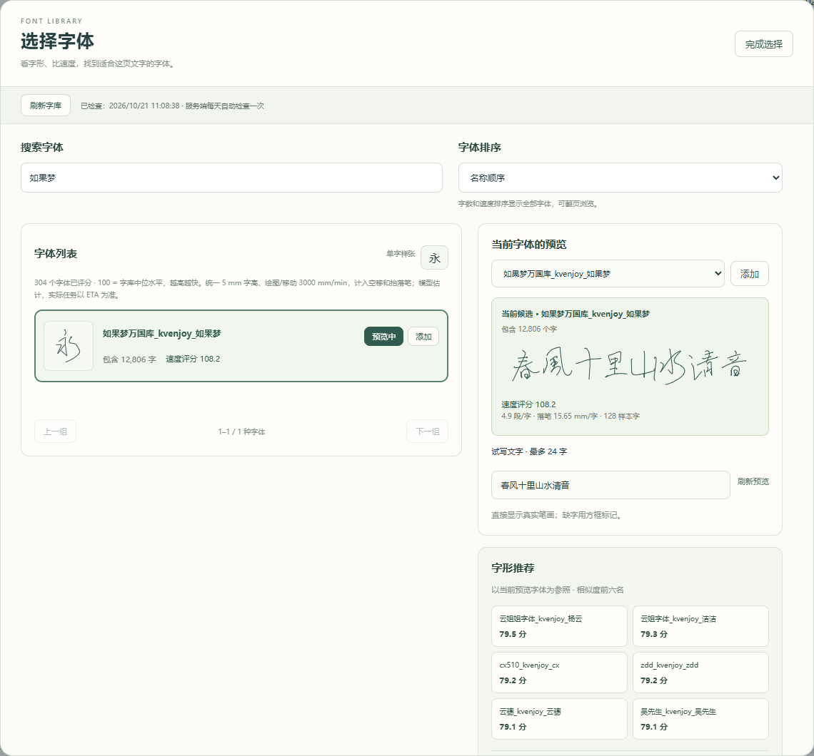
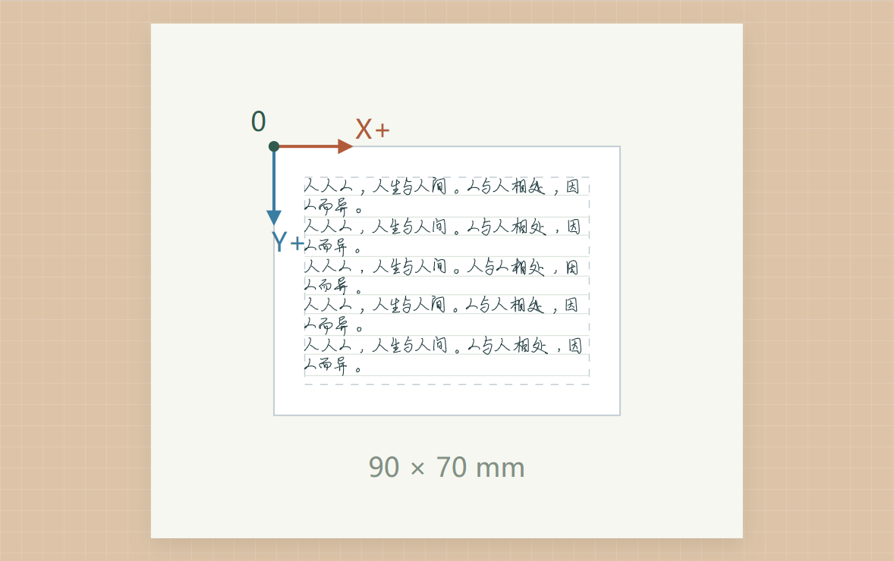
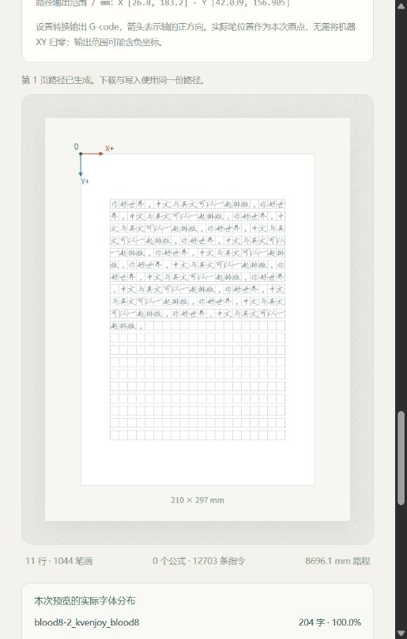

# 写字机 · xieziji

**把文字、公式和 AI 整理的内容，变成纸上的手写笔迹。**

面向 GRBL 写字机的浏览器写字台，采用 **前端、后端、控制端三端分离** 架构：前端在电脑或手机中编辑与预览，Python 后端负责排版和路径生成，独立 C++ 控制端通过 USB 串口执行任务。三端可独立部署。支持多字体混排、自然笔迹变化、多页笔记、方格书写，以及通过 MCP 接入自己的 AI 助手。

本仓库根据现有 Windows 服务器的运行源码整理，包含已部署的共享写字台、AI 接口和公式笔画处理；个人数据与部署凭据独立保存。

## 现在的优势

| 能力 | 使用体验 |
| --- | --- |
| **AI 辅助整理与排版** | 通过 MCP 接入 Codex、DeepSeek Harness（DSH），读取正文、润色内容、试排公式、查看真实笔画图像，再把结果同步到网页。模型由自己的 AI 客户端提供。 |
| **更自然的手写变化** | 多字体按作用域与权重混排，同页重复字尽量分散使用不同字体；支持大小、旋转、基线、字距、笔画末端变化，可选笔记连笔与行倾斜。 |
| **文字和公式一起写** | 支持中英文与 LaTeX 混排，包括分式、根式、上下标、矩阵、分段函数、多行等式。符号优先复用字体，缺字时可选几何笔画；支持符号大小、平滑和轻微笔迹扰动。 |
| **按真实笔画排版** | 按文字与公式的实际墨迹范围换行、避让和分页。提供笔记、方格两种模式、中英大小均衡、独立边距、固定行数／字高和行距设置。 |
| **选字体前先看效果** | 真实单线字形预览，按字数、估计速度或相似度浏览；所选组合缺字时尝试相近字体补入并高亮来源。字库变化可自动检查并重新分析。 |
| **手机、电脑接着编辑** | 同一设备共享正文、排版、预览与进度，刷新恢复原有内容，预设保存在服务端。AI 可配对与交接，退出 AI 不清空文档或停止书写。 |
| **独立控制端执行** | 完整任务上传并校验后，由 C++ 服务通过本地 USB 串口执行。网页或业务后端断开后，已启动的缓存任务仍可继续，重连读取真实状态。 |
| **进度可见、速度可调** | 任务进度、预计剩余时间、实时速度倍率、暂停／继续、终止回原点与每页完成提醒；可接入多个控制端，切换查看不停止另一台设备。 |

**预览、下载和执行使用同一份缓存路径**，开始书写时不会重新随机。无需连接机器，也可先排版并下载逐页 G-code 或整份 ZIP。

## 效果预览


<details>
<summary>查看字体选择、重复字混排与方格书写</summary>







</details>

截图为对应功能的已有预览，具体界面以当前版本为准。仓库仅附带原创英文演示字体，截图中的第三方中文字库不随源码分发。

## 快速开始：先用模拟器

需要 Python 3.10+ 与 C++17 编译器。Windows 示例使用已加入 PATH 的 MinGW `g++`：

```powershell
git clone https://github.com/QS-Ling/xieziji.git
cd xieziji
python -m pip install -r requirements-analysis.txt
.\controller\build.ps1
.\controller\build\plotter-controller.exe --simulate --jobs-dir .\controller-jobs
```

保持控制端运行，在第二个终端进入同一项目目录：

```powershell
python -m backend.server
```

打开 <http://127.0.0.1:8080>，用演示字体输入 `Hello, plotter!`，生成预览，再连接 `SIMULATOR`、确认原点并开始当前页。模拟模式运行真实 C++ 服务，不连接硬件。

### 连接真实写字机

退出模拟控制端，分别在两个终端运行：

```powershell
# 终端一
.\controller\build\plotter-controller.exe --jobs-dir .\controller-jobs
# 终端二：使用自己有权使用的 .gfont 字库
.\start.ps1 -FontDir 'C:\path\to\gcodeFonts'
```

在网页选择串口，按实际设备设置方向、纸张范围和抬落笔高度，检查预览，确认纸张与原点后开始。程序启动不会自动连接或移动机器；原厂上位机需要先释放串口。每页独立执行，换页需要人工换纸并重新确认原点。

### Linux / 树莓派控制端

```bash
cmake -S controller -B controller/build -DCMAKE_BUILD_TYPE=Release
cmake --build controller/build --parallel 2
ctest --test-dir controller/build --output-on-failure
./controller/build/plotter-controller --jobs-dir ./controller-jobs
```

另一个终端启动 `python -m backend.server`。运行用户需拥有串口访问权限，Windows 二进制不能直接用于 Linux。特殊的纸面接触启动设备需对应控制端实现，见 [部署说明](docs/deployment.md)。

## AI 怎么接入

1. 按 [MCP 接入说明](docs/mcp.md)安装可选依赖，配置 `backend/mcp_server.py` 和自己的业务服务地址。
2. 在网页打开“如何调用 AI”，占用 AI 档口并生成一次性配对码。
3. 让 AI 配对、读取文档、独立试排并查看笔画图像，再更新网页中的内容与预览。
4. 完成后退出 AI 占用，下一位可接着处理同一份文档。

AI 接口提供文档编辑、排版、预览、快照保存和状态读取；机器启动、暂停和手动动作仍在网页操作。适配器不内置模型，无需另配模型 API 密钥，模型能力与费用由所用客户端决定。

运行 `python scripts/build_mcp_client.py` 可生成源码客户端包。配置示例：[Codex](examples/mcp/codex.toml)、[DSH](examples/mcp/dsh.patch.yml)。这是通用 MCP 适配器，尚未发布为独立商店插件。

## 从内容到纸面

1. 选择笔记或方格模式，设置字体、纸张、边距与笔迹变化。
2. 输入内容或导入 UTF-8 TXT / Markdown，也可让已配对的 AI 帮助整理。
3. 生成全部页面预览，核对分页、公式、补字和范围。
4. 下载 G-code，或连接设备、确认原点后执行当前页。
5. 完成后换纸、选择下一页并重新确认。

支持保存／载入整份文档 JSON。多页文档最多 30000 个输入字符、100 个输出页，实际还受路径点数限制；超出范围会提示。

## 前端、后端、控制端三端分离

```text
电脑 / 手机浏览器 ── HTTP ── Python 业务后端 :8080
                                  │
自己的 AI 客户端 ── stdio MCP ──────┤
                                  │ HTTP：完整任务、校验、控制与状态
                                  ▼
                           C++ 控制端 :8090
                                  │ 本地 USB 串口
                                  ▼
                              GRBL 写字机
```

| 目录 | 内容 |
| --- | --- |
| `frontend/` | 原生 HTML / CSS / JavaScript 写字台，无需前端打包 |
| `backend/` | 字体解析、排版、笔迹变化、公式、SVG / G-code、共享工作区、MCP 适配器 |
| `controller/` | C++17 串口服务、任务缓存、设备检查与执行状态机；依赖头文件随仓库提供 |
| `scripts/` | 字体相似度／速度分析、演示字体与 MCP 客户端包生成 |
| `tests/` | Python 回归、C++ 核心与模拟器联调、前端状态和浏览器检查 |

业务后端使用 Python 标准库；字体自动分析额外需要 NumPy、Pillow，MCP 客户端使用可选依赖 `requirements-mcp.txt`。前端、后端和控制端可以分机部署，后端不直接操作串口。

默认仅监听本机。网络部署应配置独立的 `PLOTTER_TOKEN` 与 `CONTROLLER_TOKEN`，按需使用受保护的 HTTPS 代理或隧道。控制端地址、令牌及多机注册表只保存在服务端，详见 [部署说明](docs/deployment.md)。

## 使用边界与许可

- 面向 GRBL 串口设备，其他协议、舵机或特殊校准流程需单独适配；软件坐标不能替代实物校准。
- 手写变化和连笔采用路径几何处理，效果取决于字体、参数和机械条件；字体速度分数与 ETA 都是估算。
- 公式支持受限 LaTeX 子集，不执行 TeX、自定义宏或外部包。
- 控制端退出或断电后不提供断点续写，重启不自动连接或重放任务。
- 原创代码和演示／测试字体采用 [PolyForm Noncommercial 1.0.0](LICENSE)，用途以条款为准。第三方 C++ 依赖保留各自 MIT 许可，见 [NOTICE](NOTICE)。第三方字体、原厂软件、固件与驱动不随仓库分发。
- 个人正文、预设、设备档案、任务、私有配置与令牌不包含在源码快照中。

## 文档与验证

- [文档、分页与公式参数](docs/document-layout.md)
- [AI 配对与 MCP 工具](docs/mcp.md)
- [设备档案](docs/device-profiles.md) · [部署与多控制端](docs/deployment.md)
- [控制端协议](docs/controller-protocol.md) · [前端独立部署](frontend/README.md)
- [字体相似度](docs/font-similarity-report.md) · [字体速度模型](docs/font-speed-report.md)
- [笔迹变化参数](docs/handwriting.md)

```powershell
.\controller\build.ps1
python -m pip install -r requirements-analysis.txt
python -m unittest discover -v
```

MCP 真实调用测试还需 `python -m pip install -r requirements-mcp.txt`。浏览器测试需 Node.js、Playwright 与浏览器；C++ 二进制缺失时相关联调会跳过，不能作为完整硬件验收。
